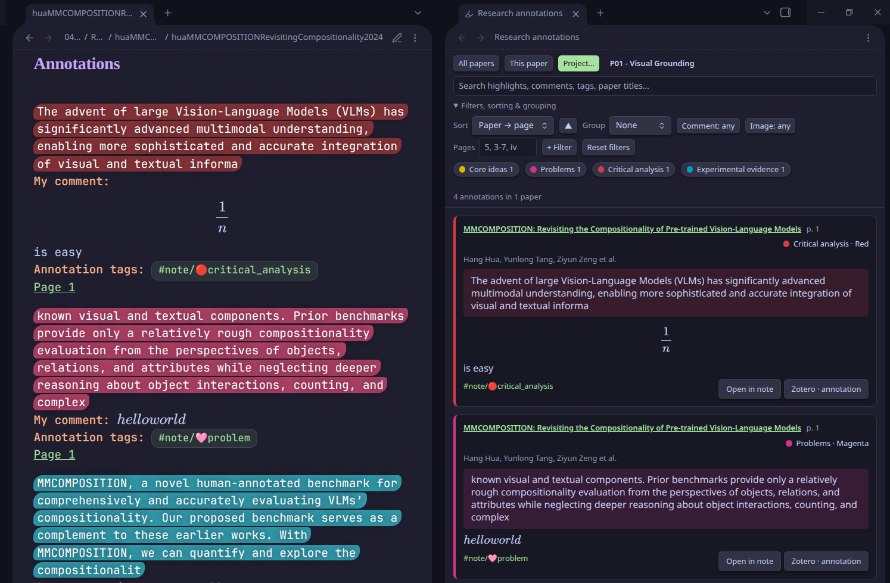

# Research Annotations

Index, search, and browse the Zotero annotations already imported into your Obsidian literature notes. The plugin works entirely on local Markdown — it does not connect to Zotero or require a separate database.

It is designed to work with the **Zotero Integration** plugin and the **Highlightr** plugin (which provides the `hltr-*` highlight classes).



## Features

- Sidebar annotation explorer for all indexed papers.
- Search highlights, comments, tags, and paper titles.
- Filter by semantic category, original highlight color, tag, paper, project, page, comment, and image presence.
- Sort by paper, page, category, or note order; group by paper, category, or project.
- Open the source note at the exact annotation line from the paper title or **Open in note** button.
- Open matching Zotero annotations, pages, PDFs, or items directly from each card.
- Configurable semantic names for Zotero colors (for example, Yellow → “Core ideas”).
- Project views via frontmatter links, with optional follow-active-note behavior.
- Incremental indexing: only notes containing annotations are stored, and changed notes are re-parsed automatically.

## Installation

1. Create the folder `.obsidian/plugins/research-annotations/` in your vault.
2. Copy `main.js`, `manifest.json`, and `styles.css` into that folder.
3. Enable **Research Annotations** in **Settings → Community plugins**.
4. Reload Obsidian after updating the plugin files.

### Building from source

```bash
npm install
npm run build
```

The build watches for changes and writes `dist/main.js`. To build directly into a vault:

```bash
OBSIDIAN_PLUGIN_DIR="/path/to/vault/.obsidian/plugins/research-annotations" npm run build
```

## Usage

1. Import Zotero annotations into your literature notes using **Zotero Integration** and the template below.
2. Open the explorer with:
   - the highlighter ribbon icon,
   - the command **Open annotation explorer (all papers)**,
   - **Open annotations for current paper**, or
   - **Open annotations for current project**.
3. Use **This paper**, **Project…**, and the filter controls to narrow the list.
4. Click a paper title or **Open in note** to jump to the annotation in its source note.

### Note properties (frontmatter)

For the explorer to show papers and projects correctly, give each literature note frontmatter like this:

```yaml
---
title: "Paper or note title"
authors:
  - "Author One"
  - "Author Two"
projects:
  - "[[VG-01 Project Name]]"
---
```

- `title` is the name shown in the explorer. It falls back to the filename.
- `authors` (or `author`) is shown on annotation cards. Both a YAML list and a single string work.
- `projects` links the paper to one or more project notes. Use `projects: []` when the paper has no project. The property name is configurable in **Settings → Research Annotations**.

The note body must also contain the imported Zotero annotations. The template below writes them inside a `%% begin annotations %%` / `%% end annotations %%` block and includes the `zotero://` links the plugin uses for stable annotation IDs and Zotero buttons.

### Parser modes

- **Legacy (used by the template below):** annotations inside the persist block are segmented using page links. Boundaries are inferred.
- **Explicit (`ra:` markers):** annotations wrapped in `%% ra:begin id="…" color="…" type="…" %%` … `%% ra:end %%` are treated as authoritative. The parser supports this mode and it is covered by automated tests, but it has not yet been manually verified in Obsidian. These are hidden Obsidian comment markers, not tags.

The template below does **not** emit `ra:` markers, so it currently uses the legacy parser. Additional updates may come in the future to use the `ra:` markers for authoritative boundaries, explicit color/type metadata, and more reliable IDs.

## Zotero Integration template

This template is known to work well with the plugin and with Highlightr’s `hltr-*` classes:

<details>
<summary>Show template</summary>

```jinja





<mark class="hltr-yellow">❝{{ annotation.annotatedText }}❞</mark>

<mark class="hltr-blue">❝{{ annotation.annotatedText }}❞</mark>

<mark class="hltr-green">❝{{ annotation.annotatedText }}❞</mark>

<mark class="hltr-cyan">❝{{ annotation.annotatedText }}❞</mark>

<mark class="hltr-purple">❝{{ annotation.annotatedText }}❞</mark>

<mark class="hltr-red">❝{{ annotation.annotatedText }}❞</mark>

<mark class="hltr-orange">❝{{ annotation.annotatedText }}❞</mark>

<mark class="hltr-pink">❝{{ annotation.annotatedText }}❞</mark>

<mark class="hltr-grey">❝{{ annotation.annotatedText }}❞</mark>




![[{{ annotation.imageRelativePath }}]]



**My comment:** {{ annotation.comment }}



**Annotation tags:** #{{ tag.tag }} 



[Page {{ annotation.pageLabel }}]({{ annotation.desktopURI }})




```

</details>

## Settings

- **Folders to index** — limit indexing to specific folders; leave empty for the whole vault.
- **Zotero Integration block name** — the name in ``.
- **Project property** — frontmatter key containing project links.
- **Infer color from tag emoji** — infer a color for annotations without a highlight color, such as image annotations.
- **Semantic color aliases** — rename Zotero colors for filtering, grouping, and display.
- **Explorer defaults** — default sort and grouping.

## Customizing

You can use Claude — or any AI coding assistant — to edit and alter the plugin as you wish: change the parser, adjust the sidebar UI, add settings, or adapt the Zotero template to your own workflow. The source is split into small modules for parsing, indexing, querying, rendering, and navigation.
